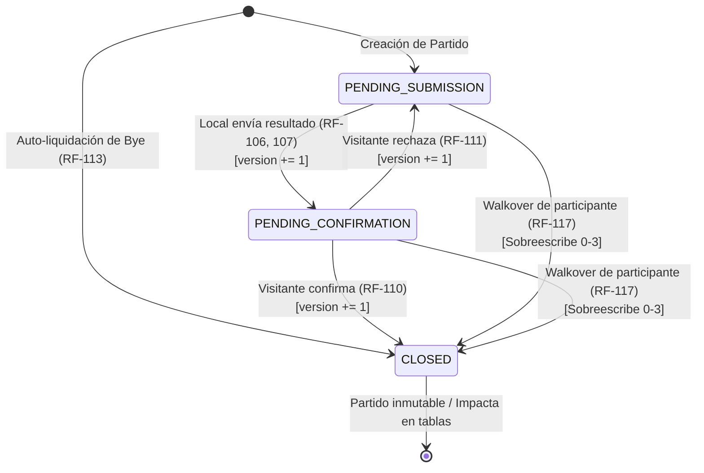

# Plan 002 — Cloud Multiplayer & Sincronización en Tiempo Real

> Implementa `specs/002-cloud-multiplayer/spec.md`. Respeta rigurosamente `docs/constitution.md`.
> Arquitectura Full-Stack en TypeScript estricto: React 19 + Tailwind en cliente, Node.js + Express + PostgreSQL (Prisma) + Socket.io en backend, lógica pura aislada en `src/domain/`.

---

## 1. Organización del Proyecto y Separación de Lógica Pura de Dominio

En estricto cumplimiento del **Principio 1** y **Principio 3** de la Constitución:

### 1.1 Estructura del Repositorio

El proyecto mantiene una estructura modular y tipada donde el cliente y el servidor comparten la misma lógica pura de dominio sin dependencias de infraestructura ni de UI:

```
/ (raíz del proyecto)
├── docs/                                  # Constitución, plan y spec activa
├── specs/                                 # Especificaciones de épicas
│   ├── 001-core-tournament/
│   └── 002-cloud-multiplayer/
├── src/                                   # Frontend (React 19 + Tailwind)
│   ├── domain/                            # LÓGICA DE NEGOCIO PURA (Isomórfica: cliente y servidor)
│   │   ├── types.ts                       # Tipos fundamentales del dominio
│   │   ├── random.ts                      # Fisher-Yates y generadores deterministas
│   │   ├── players.ts                     # Normalización y validaciones de jugadores
│   │   ├── theme.ts                       # Temáticas y filtros
│   │   ├── draft.ts                       # Lógica de asignación de equipos
│   │   ├── bracket.ts                     # Árbol de llaves y Byes
│   │   ├── league.ts                      # Algoritmo Berger y tablas Round Robin
│   │   ├── groupStage.ts                  # Fase de grupos y clasificación
│   │   ├── leaguePlayoffs.ts              # Liga + Reducido
│   │   ├── doubleElimination.ts           # Winner / Loser bracket y Bracket Reset
│   │   ├── fairPlay.ts                    # Desempate jerárquico (PTS, DG, H2H, PG, TR, TA)
│   │   ├── scenarios.ts                   # Calculadora matemática de clasificación
│   │   ├── awardsAndRankings.ts           # Bota de Oro, Madera, Valla Invicta y Ranking Anual
│   │   ├── handshake.ts                   # [NUEVO] Máquina de estados pura de partidos y validaciones
│   │   ├── voting.ts                      # [NUEVO] Lógica pura de temporizadores, quórum y desempates de votos
│   │   ├── sequentialLock.ts              # [NUEVO] Regla pura de bloqueo secuencial por jugador
│   │   └── walkover.ts                    # [NUEVO] Aplicación de 0-3 y liquidación atómica de partidos
│   ├── context/                           # Contextos de React (Auth, Tournament, Socket)
│   ├── hooks/                             # useNetworkStatus, useTournamentSocket, useCountdown
│   ├── components/                        # Componentes UI (Lobby, Bracket, Standings, HandshakeModal)
│   ├── cache/                             # Réplica local en localStorage / IndexedDB para Modo Offline
│   ├── App.tsx                            # Router por estado y layout principal
│   └── main.tsx                           # Punto de entrada Vite
├── server/                                # Backend (Node.js + Express + Socket.io)
│   ├── prisma/                            # Schema y migraciones de PostgreSQL
│   │   └── schema.prisma
│   └── src/
│       ├── config/                        # Variables de entorno y seed de admin inicial
│       ├── auth/                          # Google OAuth 2.0 y JWT de sesión
│       ├── middleware/                    # authMiddleware, whitelistMiddleware, errorHandler
│       ├── routes/                        # Endpoints REST (/api/auth, /api/whitelist, /api/tournaments, /api/matches)
│       ├── sockets/                       # Handlers de Socket.io y salas por torneo
│       ├── services/                      # Orquestación de BD usando src/domain/
│       └── index.ts                       # Inicialización de Express y servidor HTTP/WebSocket
├── package.json                           # Scripts y dependencias unificadas
└── tsconfig.json                          # TypeScript estricto de punta a punta
```

### 1.2 Reglas de Aislamiento de Dominio

- Ningún archivo en `src/domain/` puede importar paquetes externos, librerías de UI (React, Tailwind), bases de datos (Prisma) ni protocolos de red (Express, Socket.io).
- Toda función de dominio es pura: recibe parámetros, devuelve nuevos estados o cálculos inmutables y no genera efectos secundarios.
- Tanto los controladores y servicios de `server/src/services/` como los reducers y componentes de `src/` consumen los mismos módulos de `src/domain/`.

---

## 2. Esquema de Base de Datos Relacional (PostgreSQL + Prisma ORM)

Se define el esquema relacional en `server/prisma/schema.prisma` garantizando integridad referencial, transacciones atómicas y control de concurrencia optimista (`version`):

```prisma
datasource db {
  provider = "postgresql"
  url      = env("DATABASE_URL")
}

generator client {
  provider = "prisma-client-js"
}

enum Role {
  ADMIN
  PLAYER
}

enum TournamentStatus {
  LOBBY
  VOTING_FORMAT
  VOTING_THEME
  IN_PROGRESS
  COMPLETED
  ABANDONED
}

enum TournamentFormat {
  BRACKET
  LEAGUE
  GROUP_STAGE
  LEAGUE_PLAYOFFS
  DOUBLE_ELIMINATION
}

enum MatchFormat {
  SINGLE_MATCH
  TWO_LEGGED
}

enum MatchStatus {
  PENDING_SUBMISSION
  PENDING_CONFIRMATION
  CLOSED
}

enum VotePhase {
  FORMAT
  THEME
}

model User {
  id        String   @id @default(uuid())
  email     String   @unique
  name      String
  googleId  String   @unique
  role      Role     @default(PLAYER)
  playerId  String?  @unique
  player    Player?  @relation(fields: [playerId], references: [id])
  createdAt DateTime @default(now())
  updatedAt DateTime @updatedAt
}

model WhitelistEntry {
  id        String   @id @default(uuid())
  email     String   @unique
  role      Role     @default(PLAYER)
  playerId  String?
  createdAt DateTime @default(now())
  updatedAt DateTime @updatedAt
}

model Player {
  id             String                  @id @default(uuid())
  firstName      String
  lastName       String
  user           User?
  participants   TournamentParticipant[]
  h2hAsPlayerA   HeadToHeadRecord[]      @relation("PlayerA")
  h2hAsPlayerB   HeadToHeadRecord[]      @relation("PlayerB")
  annualRankings AnnualRankingEntry[]
  stats          HistoricalStats?
  createdAt      DateTime                @default(now())
  updatedAt      DateTime                @updatedAt

  @@unique([firstName, lastName])
}

model Tournament {
  id               String                  @id @default(uuid())
  name             String
  status           TournamentStatus        @default(LOBBY)
  format           TournamentFormat?
  matchFormat      MatchFormat?
  theme            String?
  participantCount Int                     @default(0)
  currentRound     Int                     @default(1)
  settings         Json?
  winnerId         String?
  participants     TournamentParticipant[]
  matches          Match[]
  votes            TournamentVote[]
  createdAt        DateTime                @default(now())
  updatedAt        DateTime                @updatedAt
}

model TournamentParticipant {
  id           String      @id @default(uuid())
  tournamentId String
  tournament   Tournament  @relation(fields: [tournamentId], references: [id], onDelete: Cascade)
  playerId     String
  player       Player      @relation(fields: [playerId], references: [id])
  teamName     String?
  seed         Int?
  isPresent    Boolean     @default(true)
  isWalkover   Boolean     @default(false)
  walkoverAt   DateTime?
  homeMatches  Match[]     @relation("HomeParticipant")
  awayMatches  Match[]     @relation("AwayParticipant")
  penaltiesWon Match[]     @relation("PenaltiesWinner")
  createdAt    DateTime    @default(now())
  updatedAt    DateTime    @updatedAt

  @@unique([tournamentId, playerId])
}

model Match {
  id                          String                @id @default(uuid())
  tournamentId                String
  tournament                  Tournament            @relation(fields: [tournamentId], references: [id], onDelete: Cascade)
  round                       Int
  leg                         Int                   @default(1) // 1 = Ida / Partido Único, 2 = Vuelta
  seriesId                    String?               // Agrupa partidos de la misma serie en Ida y Vuelta
  homeParticipantId           String
  homeParticipant             TournamentParticipant @relation("HomeParticipant", fields: [homeParticipantId], references: [id])
  awayParticipantId           String
  awayParticipant             TournamentParticipant @relation("AwayParticipant", fields: [awayParticipantId], references: [id])
  status                      MatchStatus           @default(PENDING_SUBMISSION)
  isBye                       Boolean               @default(false)
  
  // Marcadores y Fair Play
  homeScore                   Int?
  awayScore                   Int?
  homeYellowCards             Int                   @default(0)
  awayYellowCards             Int                   @default(0)
  homeRedCards                Int                   @default(0)
  awayRedCards                Int                   @default(0)
  penaltiesWinnerId           String?
  penaltiesWinner             TournamentParticipant? @relation("PenaltiesWinner", fields: [penaltiesWinnerId], references: [id])
  
  // Control de Concurrencia Optimista (OCC)
  version                     Int                   @default(1)
  submittedByParticipantId    String?
  submittedAt                 DateTime?
  closedAt                    DateTime?
  createdAt                   DateTime              @default(now())
  updatedAt                   DateTime              @updatedAt

  @@index([tournamentId, round])
}

model TournamentVote {
  id            String                @id @default(uuid())
  tournamentId  String
  tournament    Tournament            @relation(fields: [tournamentId], references: [id], onDelete: Cascade)
  participantId String
  phase         VotePhase
  choice        String
  createdAt     DateTime              @default(now())

  @@unique([tournamentId, participantId, phase])
}

model HistoricalStats {
  id            String   @id @default(uuid())
  playerId      String   @unique
  player        Player   @relation(fields: [playerId], references: [id], onDelete: Cascade)
  matchesPlayed Int      @default(0)
  matchesWon    Int      @default(0)
  matchesDrawn  Int      @default(0)
  matchesLost   Int      @default(0)
  goalsFor      Int      @default(0)
  goalsAgainst  Int      @default(0)
  yellowCards   Int      @default(0)
  redCards      Int      @default(0)
  podiums       Int      @default(0)
  firstPlaces   Int      @default(0)
  secondPlaces  Int      @default(0)
  thirdPlaces   Int      @default(0)
  updatedAt     DateTime @updatedAt
}

model HeadToHeadRecord {
  id            String   @id @default(uuid())
  playerAId     String
  playerA       Player   @relation("PlayerA", fields: [playerAId], references: [id], onDelete: Cascade)
  playerBId     String
  playerB       Player   @relation("PlayerB", fields: [playerBId], references: [id], onDelete: Cascade)
  matchesPlayed Int      @default(0)
  winsA         Int      @default(0)
  winsB         Int      @default(0)
  draws         Int      @default(0)
  goalsA        Int      @default(0)
  goalsB        Int      @default(0)
  updatedAt     DateTime @updatedAt

  @@unique([playerAId, playerBId])
}

model AnnualRankingEntry {
  id                String   @id @default(uuid())
  year              Int
  playerId          String
  player            Player   @relation(fields: [playerId], references: [id], onDelete: Cascade)
  points            Int      @default(0)
  tournamentsPlayed Int      @default(0)
  podiums           Int      @default(0)
  yellowCards       Int      @default(0)
  redCards          Int      @default(0)
  updatedAt         DateTime @updatedAt

  @@unique([year, playerId])
}
```

---

## 3. Contrato API REST y Catálogo de Eventos WebSocket

### 3.1 Endpoints REST

Todas las rutas HTTP validan la sesión autenticada con Google mediante `authMiddleware` y verifican la pertenencia a la `WhitelistEntry`.

#### Autenticación y Whitelist
- `GET /api/auth/google`: Inicia el flujo OAuth 2.0 con Google.
- `GET /api/auth/google/callback`: Recibe el callback de Google, valida whitelist y emite cookie `httpOnly` con JWT.
- `GET /api/auth/me`: Retorna los datos del usuario logueado, su rol y su perfil de jugador.
- `POST /api/auth/logout`: Invalida la sesión.
- `GET /api/whitelist`: (Solo Admin) Lista los correos autorizados y su vinculación.
- `POST /api/whitelist`: (Solo Admin) Agrega un correo y lo asocia opcionalmente a un `playerId`.
- `DELETE /api/whitelist/:id`: (Solo Admin) Da de baja un correo de la lista blanca.

#### Torneo y Lobby
- `GET /api/tournaments/active`: Obtiene el torneo activo (o null si no hay ninguno).
- `POST /api/tournaments/lobby`: Crea un nuevo torneo en estado `LOBBY` (falla con 409 si ya existe un torneo activo).
- `POST /api/tournaments/lobby/presence`: Confirma asistencia del jugador logueado.
- `DELETE /api/tournaments/lobby/presence`: Cancela asistencia del jugador logueado.
- `DELETE /api/tournaments/lobby/participants/:id`: (Solo Admin) Remueve a un jugador del lobby antes de iniciar.
- `POST /api/tournaments/start-voting`: Pasa el torneo a `VOTING_FORMAT` si se cumple el quórum ($\ge 4$).
- `POST /api/tournaments/vote`: Emite un voto (`{ phase: 'FORMAT' | 'THEME', choice: string }`).

#### Partidos y Handshake
- `POST /api/matches/:id/submit`:
  - **Autorización:** Exclusivo para el jugador Local (`homeParticipant.playerId === user.playerId`).
  - **Body:** `{ homeScore, awayScore, homeYellowCards, awayYellowCards, homeRedCards, awayRedCards, penaltiesWinnerId?, expectedVersion }`.
  - **Comportamiento:** Si `match.version !== expectedVersion`, responde `409 Conflict`. Si coincide, transiciona a `PENDING_CONFIRMATION`, incrementa `version += 1`, y emite WebSocket `match:submitted`.
- `POST /api/matches/:id/confirm`:
  - **Autorización:** Exclusivo para el jugador Visitante (`awayParticipant.playerId === user.playerId`).
  - **Body:** `{ expectedVersion }`.
  - **Comportamiento:** Si `match.version !== expectedVersion`, responde `409 Conflict`. Si coincide, transiciona a `CLOSED`, incrementa `version += 1`, ejecuta el recálculo atómico de tabla/bracket en Prisma, y emite WebSocket `match:closed`.
- `POST /api/matches/:id/reject`:
  - **Autorización:** Exclusivo para el jugador Visitante.
  - **Body:** `{ expectedVersion }`.
  - **Comportamiento:** Si `match.version !== expectedVersion`, responde `409 Conflict`. Si coincide, revierte a `PENDING_SUBMISSION`, incrementa `version += 1`, y emite WebSocket `match:rejected`.

#### Walkovers y Reglamento
- `POST /api/tournaments/participants/:id/walkover`:
  - **Autorización:** El propio jugador (auto-walkover) o el Admin (administrativo).
  - **Comportamiento:** Transacción atómica que sobreescribe todos sus partidos en 0-3, los cierra (`CLOSED`), autoconfirma sin handshake y desbloquea rivales. Emite WebSocket `walkover:applied`.
- `GET /api/rules`: Devuelve el documento estático con el reglamento oficial de la casa.
- `GET /api/history/standings`, `GET /api/history/annual-rankings`, `GET /api/history/h2h`: Datos históricos acumulados.

### 3.2 Catálogo de Eventos WebSocket (Socket.io)

Todos los clientes se unen a la sala `tournament:<tournamentId>`.

| Evento | Dirección | Payload | Propósito |
|---|---|---|---|
| `lobby:updated` | Servidor $\rightarrow$ Clientes | `{ participants: TournamentParticipant[], count: number, canStart: boolean }` | Actualiza la lista de presentes en vivo. |
| `vote:started` | Servidor $\rightarrow$ Clientes | `{ phase: 'FORMAT' \| 'THEME', options: string[], expiresAt: string }` | Inicia la cuenta regresiva sincronizada (120s). |
| `vote:updated` | Servidor $\rightarrow$ Clientes | `{ votesCast: number, totalVoters: number }` | Progreso de votos en vivo. |
| `vote:ended` | Servidor $\rightarrow$ Clientes | `{ winner: string, wasDraw: boolean, tiedOptions?: string[] }` | Notifica el formato/temática electo y si hubo desempate al azar. |
| `draw:animated` | Servidor $\rightarrow$ Clientes | `{ step: number, currentItem: string, targetParticipantId?: string, isFinal: boolean }` | Animación sincronizada cuadro por cuadro en todos los dispositivos. |
| `fixture:ready` | Servidor $\rightarrow$ Clientes | `{ matches: Match[], currentRound: number }` | Fixture inicial con Byes auto-liquidados. |
| `match:submitted` | Servidor $\rightarrow$ Clientes | `{ matchId: string, version: number, homeScore: number, awayScore: number, penaltiesWinnerId?: string }` | Notifica al visitante que debe confirmar/rechazar. |
| `match:rejected` | Servidor $\rightarrow$ Clientes | `{ matchId: string, version: number }` | Devuelve el partido a pendiente de carga. |
| `match:closed` | Servidor $\rightarrow$ Clientes | `{ matchId: string, version: number, standings: any, bracket: any, unblockedParticipants: string[] }` | Cierre inmutable, tabla recalculada y notificación de desbloqueo. |
| `walkover:applied` | Servidor $\rightarrow$ Clientes | `{ participantId: string, affectedMatches: string[], standings: any, bracket: any }` | Notificación de abandono 0-3 y liberación de rivales. |
| `tournament:finished`| Servidor $\rightarrow$ Clientes | `{ podium: any, annualPointsDistributed: any }` | Coronación y podio final. |

---

## 4. Máquina de Estados del Partido (Handshake)

### 4.1 Diagrama de Estados y Transiciones



### 4.2 Lógica Pura en `src/domain/handshake.ts`

```typescript
export interface MatchState {
  id: string;
  homeParticipantId: string;
  awayParticipantId: string;
  status: 'PENDING_SUBMISSION' | 'PENDING_CONFIRMATION' | 'CLOSED';
  homeScore: number | null;
  awayScore: number | null;
  homeYellowCards: number;
  awayYellowCards: number;
  homeRedCards: number;
  awayRedCards: number;
  penaltiesWinnerId: string | null;
  version: number;
  isBye: boolean;
}

export function transitionMatchSubmit(
  match: MatchState,
  actorParticipantId: string,
  payload: {
    homeScore: number;
    awayScore: number;
    homeYellowCards: number;
    awayYellowCards: number;
    homeRedCards: number;
    awayRedCards: number;
    penaltiesWinnerId?: string | null;
    expectedVersion: number;
  }
): MatchState {
  if (match.status !== 'PENDING_SUBMISSION') {
    throw new Error('El partido no está pendiente de carga.');
  }
  if (actorParticipantId !== match.homeParticipantId) {
    throw new Error('Solo el jugador Local puede cargar el resultado.');
  }
  if (match.version !== payload.expectedVersion) {
    throw new Error('Conflicto de concurrencia: el partido fue modificado previamente.');
  }
  return {
    ...match,
    status: 'PENDING_CONFIRMATION',
    homeScore: payload.homeScore,
    awayScore: payload.awayScore,
    homeYellowCards: payload.homeYellowCards,
    awayYellowCards: payload.awayYellowCards,
    homeRedCards: payload.homeRedCards,
    awayRedCards: payload.awayRedCards,
    penaltiesWinnerId: payload.penaltiesWinnerId ?? null,
    version: match.version + 1,
  };
}

export function transitionMatchConfirm(
  match: MatchState,
  actorParticipantId: string,
  expectedVersion: number
): MatchState {
  if (match.status !== 'PENDING_CONFIRMATION') {
    throw new Error('El partido no está esperando confirmación.');
  }
  if (actorParticipantId !== match.awayParticipantId) {
    throw new Error('Solo el jugador Visitante puede confirmar el resultado.');
  }
  if (match.version !== expectedVersion) {
    throw new Error('Conflicto de concurrencia: el resultado fue modificado mientras confirmabas.');
  }
  return {
    ...match,
    status: 'CLOSED',
    version: match.version + 1,
  };
}

export function transitionMatchReject(
  match: MatchState,
  actorParticipantId: string,
  expectedVersion: number
): MatchState {
  if (match.status !== 'PENDING_CONFIRMATION') {
    throw new Error('El partido no está esperando confirmación.');
  }
  if (actorParticipantId !== match.awayParticipantId) {
    throw new Error('Solo el jugador Visitante puede rechazar el resultado.');
  }
  if (match.version !== expectedVersion) {
    throw new Error('Conflicto de concurrencia: el resultado fue modificado previamente.');
  }
  return {
    ...match,
    status: 'PENDING_SUBMISSION',
    version: match.version + 1,
  };
}
```

---

## 5. Decisiones de Arquitectura Técnica y Tolerancia a Desconexiones en el Cliente

### 5.1 Estrategia de Caché y Modo Offline

En estricto cumplimiento del **Principio 5** de la Constitución:

1. **Almacenamiento Local de Respaldo:** Cada vez que el cliente frontend recibe una actualización del torneo activo (`GET /api/tournaments/active` o eventos de Socket), persiste una copia serializada en `localStorage` bajo la clave `second-is-last:cloud-cache`.
2. **Detección Activa de Conectividad:**
   - El hook personalizado `useNetworkStatus` monitorea tanto `navigator.onLine` como el estado de conexión del socket (`socket.on('disconnect')` y `socket.on('connect_error')`).
   - Si no hay conexión tras 3 segundos de reintentos, el estado del contexto conmuta a `isOffline: true`.
3. **Comportamiento Visual en Modo Offline:**
   - La interfaz despliega un banner persistente en la cabecera: *"⚠️ Modo Offline (Sin conexión) — Podés consultar tablas y cruces; la carga de resultados está pausada hasta que vuelva internet."*
   - Todos los botones de mutación (`Enviar resultado`, `Confirmar`, `Rechazar`, `Votar`) se deshabilitan visualmente y muestran un tooltip informativo.
   - Las vistas de Tablas, Llaves, Escenarios y Reglamento continúan operando con los datos en caché sin recargas ni pantallas en blanco.
4. **Rehidratación Automática:**
   - Socket.io opera con reconexión automática y backoff exponencial (`reconnectionAttempts: Infinity`, `reconnectionDelay: 1000`, `reconnectionDelayMax: 5000`).
   - Al reconectar (`socket.on('connect')`), el cliente invoca automáticamente `GET /api/tournaments/active`, sincroniza el estado más reciente, oculta el banner de offline y restablece la interactividad.

---

## 6. Plan de Migración de Datos Locales a la Nube

Para preservar el historial acumulado de las versiones 1.0 y 2.0 locales sin perder jugadores, podios, H2H ni el Ranking Anual:

1. **Exportación desde Cliente:** En la vista de Configuración / Historial del frontend existente, se proveerá la opción de exportar el estado actual (`AppData` con `schemaVersion: 2`).
2. **Endpoint de Migración Inicial en Backend (`POST /api/admin/migrate-local-data`):**
   - Protegido exclusivamente para el usuario con rol `ADMIN`.
   - Recibe el payload completo de `AppData`.
   - Ejecuta una transacción Prisma (`prisma.$transaction`) que:
     - Crea o actualiza los registros de `Player` correspondientes a cada nombre y apellido registrado.
     - Inserta los registros acumulados de `HistoricalStats` (PJ, PG, PE, PP, GF, GC, TR, TA, Podios).
     - Inserta la matriz de enfrentamientos en `HeadToHeadRecord`.
     - Inserta los puntajes del Ranking Anual en `AnnualRankingEntry`.
     - Registra a los jugadores en la `WhitelistEntry` inicial para permitirles autenticarse con sus cuentas de Google.
3. **Idempotencia:** La migración valida la no duplicación de registros por clave única compuesta (`[firstName, lastName]`, `[playerAId, playerBId]`, `[year, playerId]`).

---

## 7. Mapeo de Requisitos Funcionales (Cobertura RF-88 a RF-120)

| Requisito Funcional | Componente de Arquitectura / Archivo Responsable |
|---|---|
| **RF-88** (Google OAuth) | `server/src/auth/google.ts`, `server/src/routes/auth.ts` |
| **RF-89** (Validación Whitelist) | `server/src/middleware/whitelistMiddleware.ts` |
| **RF-90** (Vinculación de Perfil) | `server/src/services/userService.ts`, `server/prisma/schema.prisma` (`User.player`) |
| **RF-91, RF-92** (Gestión Whitelist & Seed Admin) | `server/src/routes/whitelist.ts`, `server/src/config/seed.ts` |
| **RF-93, RF-94, RF-95** (Lobby y Presencia) | `server/src/routes/tournament.ts`, `server/src/sockets/lobbyHandler.ts` |
| **RF-96, RF-97, RF-98** (Quórum $\ge 4$ y Unicidad) | `src/domain/voting.ts`, `server/src/services/tournamentService.ts` |
| **RF-99, RF-100, RF-101** (Votación Formato y Filtros) | `src/domain/voting.ts`, `server/src/sockets/votingHandler.ts` |
| **RF-102, RF-103, RF-104** (Temática, Equipos y Sorteos) | `src/domain/draft.ts`, `src/domain/random.ts`, `server/src/sockets/drawHandler.ts` |
| **RF-105** (Handshake atómico e Ida/Vuelta) | `src/domain/handshake.ts`, `server/prisma/schema.prisma` (`Match.leg`) |
| **RF-106, RF-107, RF-108** (Carga Local y Validación Visitante) | `src/domain/handshake.ts`, `server/src/routes/matches.ts` |
| **RF-109, RF-110, RF-111** (OCC por `version` y Cierre) | `src/domain/handshake.ts`, `server/src/services/matchService.ts` |
| **RF-112** (Inviolabilidad de Resultados por Admin) | `server/src/middleware/antiTamperMiddleware.ts` |
| **RF-113** (Auto-liquidación de Byes) | `src/domain/bracket.ts`, `server/src/services/tournamentService.ts` |
| **RF-114, RF-115** (Bloqueo Secuencial por Jugador) | `src/domain/sequentialLock.ts`, `server/src/services/matchService.ts` |
| **RF-116, RF-117** (Walkovers 0-3 y Desbloqueo) | `src/domain/walkover.ts`, `server/src/services/walkoverService.ts` |
| **RF-118** (Reglamento Oficial de la Casa) | `server/src/routes/rules.ts`, `src/components/RulesView.tsx` |
| **RF-119** (Paridad Responsive Móvil y PC) | `src/index.css`, Tailwind tokens, `src/components/` |
| **RF-120** (Modo Offline en Cliente) | `src/hooks/useNetworkStatus.ts`, `src/cache/offlineStore.ts`, `src/App.tsx` |
